<p align="center">
  <picture>
    <source media="(prefers-color-scheme: dark)" srcset="Docs/images/hero-dark.png">
    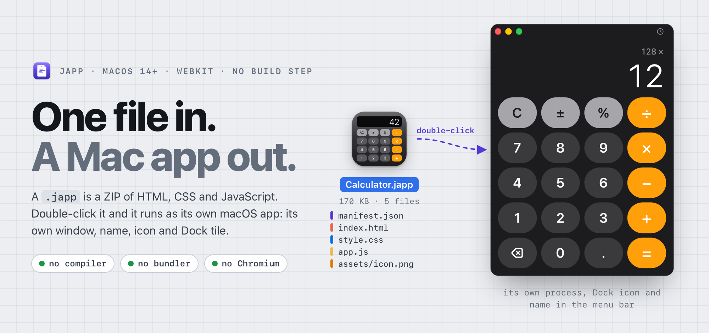
  </picture>
</p>

<h1 align="center">JApp</h1>

<p align="center">
  <b>Applications as documents.</b> A whole Mac app in one <code>.japp</code> file:<br>
  double-click it to run, right-click it to change it.
</p>

<p align="center">
  
  
  
  
</p>

A JApp is a single `.japp` file — a ZIP of HTML, CSS, JavaScript and a
`manifest.json`. Double-click it and it runs as a native macOS app with its own
window, title, icon and Dock tile. Right-click it and choose **Edit JApp Source**
to change it; save, and the new version runs.

No Xcode, compiler, Node.js, npm or bundler is needed to make or run an app —
only the JApp Runtime, installed once. Apps run in the system's WebKit engine
(no Chromium), so the runtime is small and each app is a few kilobytes.

**Giving it to someone who doesn't have JApp?** `japp export` turns the same file
into an ordinary, signed `Calculator.app` of about 2 MB with the runtime inside:
they double-click it and it runs, with nothing to install. [Share it ↓](#share-it)

## The loop

<picture>
  <source media="(prefers-color-scheme: dark)" srcset="Docs/images/loop-dark.png">
  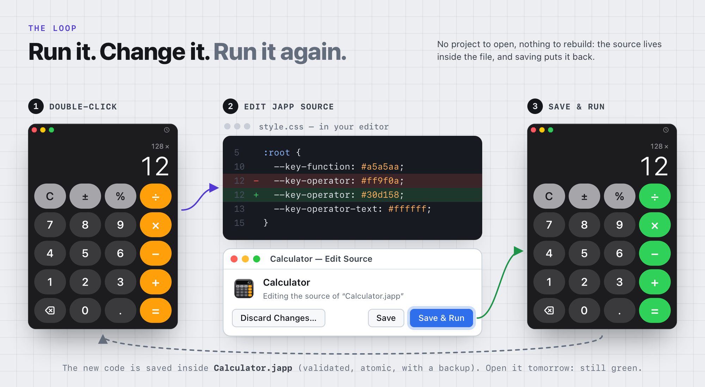
</picture>

## Quick start

Requirements: macOS 14 or later (developed and tested on macOS 26.5, Apple
Silicon) and the Swift toolchain (Xcode or Command Line Tools) to build the runtime.

```sh
Scripts/build.sh          # builds build/JApp Runtime.app and build/Calculator.japp
Scripts/install.sh        # installs to /Applications, registers .japp, installs the `japp` command
open build/Calculator.japp
```

Then try the loop from the picture above:

1. Double-click `build/Calculator.japp` in Finder — the calculator opens.
2. Right-click it › *Services* › **Edit JApp Source** (or *File › Edit Source…* in the app).
3. In `style.css`, change `--key-operator: #ff9f0a;` to `--key-operator: #30d158;`.
4. Click **Save & Run** — the operator keys turn green. Reopen the file later: still green.

## Examples

<p align="center">
  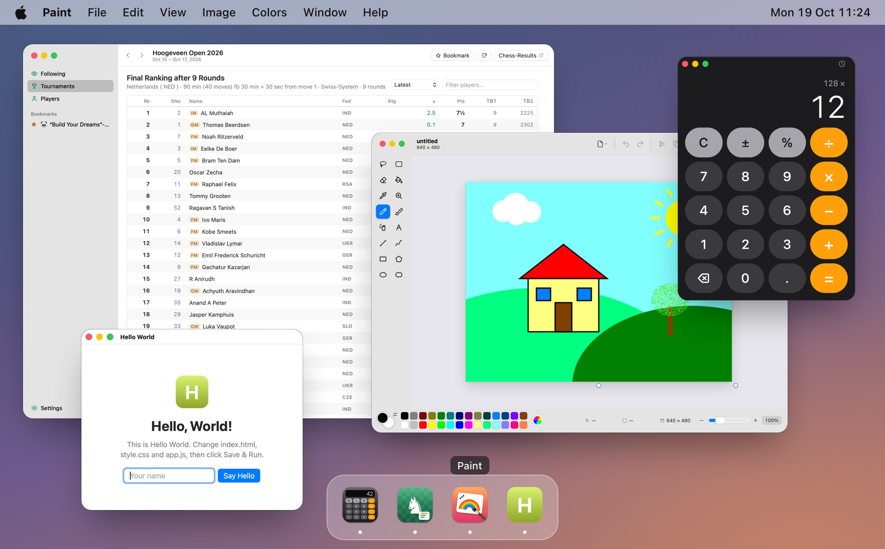
</p>

Every app runs as its own process, with its own name in the menu bar and its own
Dock icon. `Scripts/build.sh` packs every folder in `Examples/` into `build/<Name>.japp`.

<table>
  <tr>
    <td width="50%" valign="top">
      <a href="Examples/Calculator">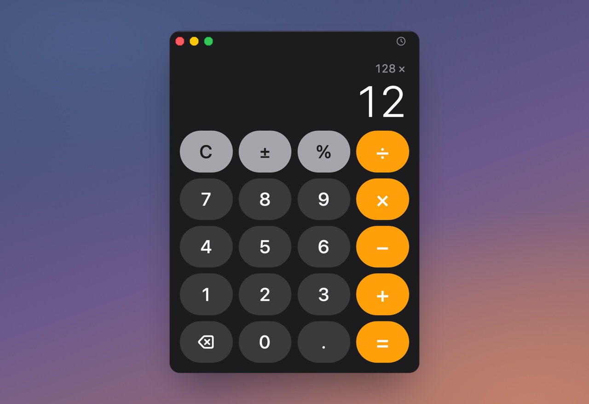</a>
      <p><b><a href="Examples/Calculator">Calculator</a></b> — the reference app: plain
      HTML/CSS/JS, history in <code>japp.storage</code>, hidden title bar.</p>
    </td>
    <td width="50%" valign="top">
      <a href="Examples/ChessResults">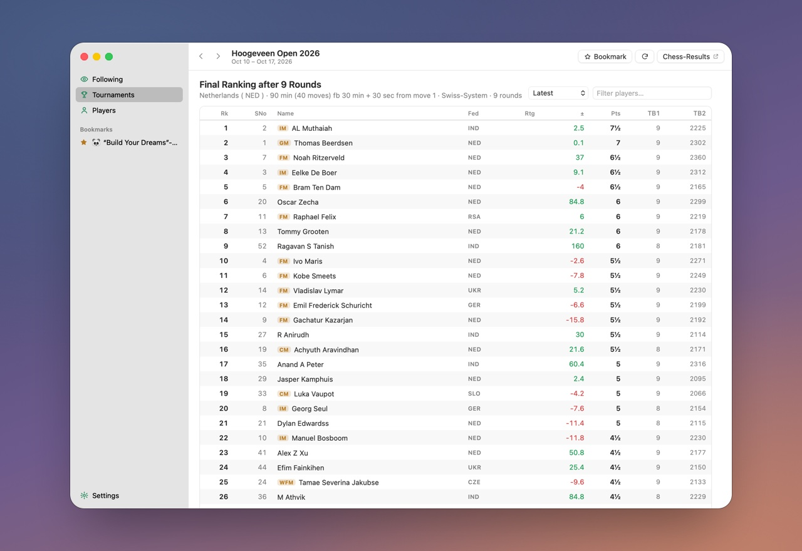</a>
      <p><b><a href="Examples/ChessResults">Chess Results</a></b> — a client for the
      <a href="https://github.com/alexzavalny/ChessResultsApi">Easy Chess Results API</a>:
      tournament search, standings, player results, followed players with notifications.
      <code>japp.http.fetch</code>, ES modules and a hash router, no build step; a
      translucent sidebar, unified toolbar and native context menus.</p>
    </td>
  </tr>
  <tr>
    <td width="50%" valign="top">
      <a href="Examples/Paint">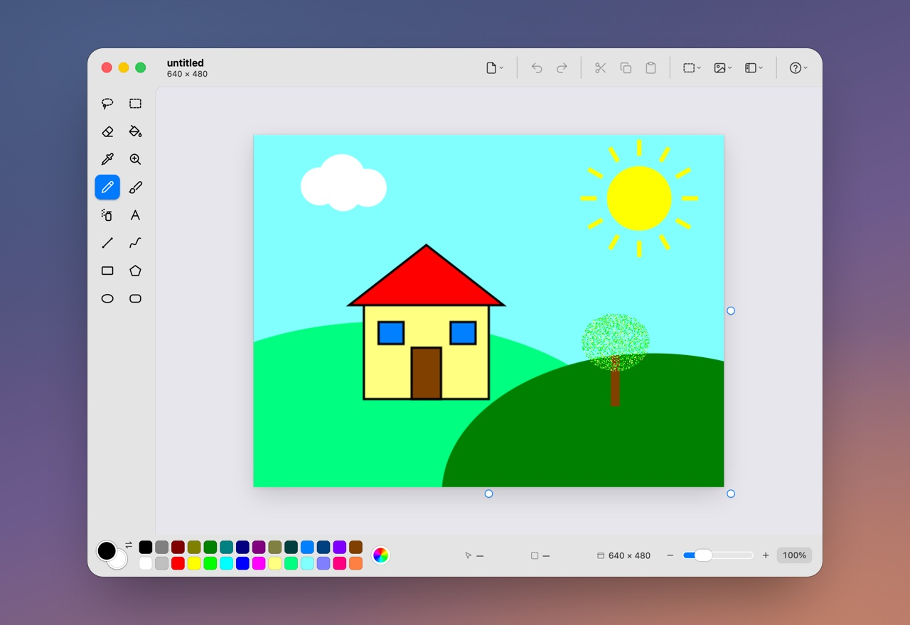</a>
      <p><b><a href="Examples/Paint">Paint</a></b> — the tool set of Windows 98 Paint in a
      present-day Mac window: all sixteen tools, the 28-colour box, flip/rotate,
      stretch/skew, zoom with pixel grid, undo, and PNG/BMP/JPEG files through
      <code>japp.dialog</code>. Menus are real macOS menus (<code>japp.menu.popup</code>
      with SF Symbols and shortcuts); pixels are still drawn without anti-aliasing.</p>
    </td>
    <td width="50%" valign="top">
      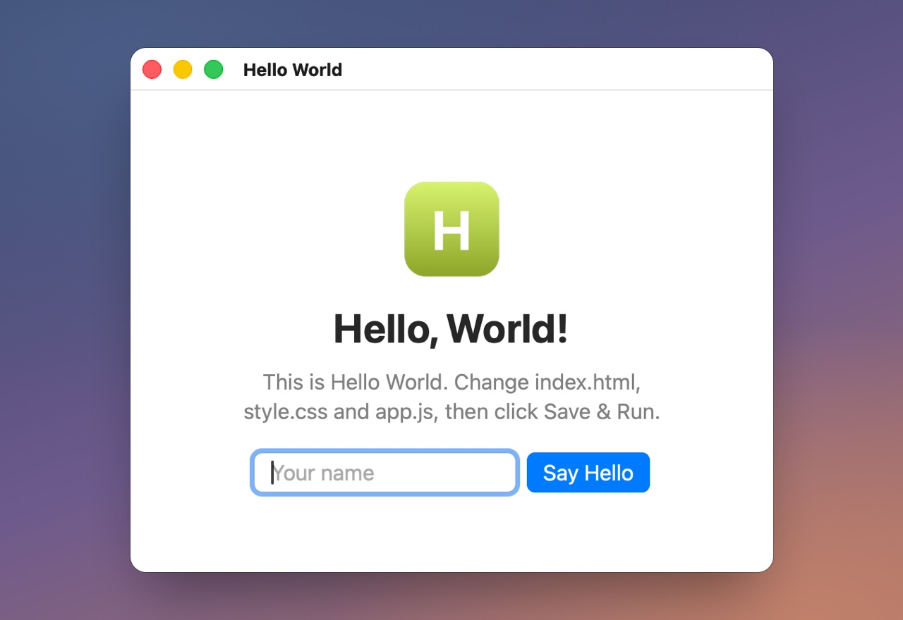
      <p><b>Hello World</b> — what every new app starts as (<i>File › New App…</i> or
      <code>japp new</code>): a greeting, a text field and a button, with the name kept
      in <code>japp.storage</code>.</p>
    </td>
  </tr>
</table>

## Inside a `.japp`

<picture>
  <source media="(prefers-color-scheme: dark)" srcset="Docs/images/anatomy-dark.png">
  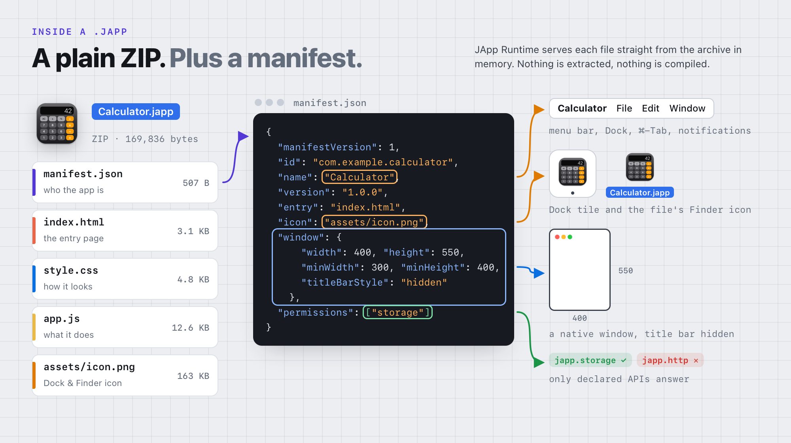
</picture>

A plain ZIP with `manifest.json` at the root ([FORMAT.md](Docs/FORMAT.md)). Rename
it to `.zip` and Archive Utility opens it; JApp Runtime reads it in place.

```json
{
  "manifestVersion": 1,
  "id": "com.example.calculator",
  "name": "Calculator",
  "version": "1.0.0",
  "entry": "index.html",
  "icon": "assets/icon.png",
  "window": { "width": 400, "height": 550, "minWidth": 300, "minHeight": 400, "resizable": true },
  "permissions": ["storage"]
}
```

## Make your own

<picture>
  <source media="(prefers-color-scheme: dark)" srcset="Docs/images/new-app-dark.png">
  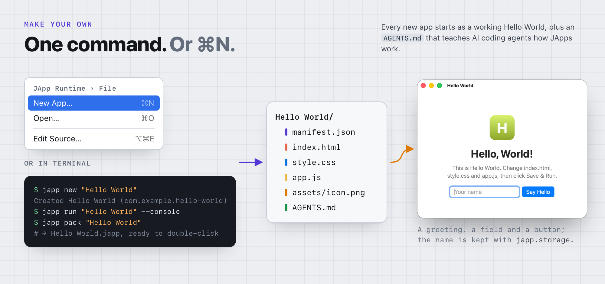
</picture>

Open JApp Runtime and choose **File › New App…** (⌘N; also a button in its
welcome window). Name the app and pick a folder: JApp writes `<Name>.japp` — a
"Hello, World!" app with a greeting, a text field and a button, plus an `AGENTS.md`
that tells AI coding agents how JApps work — and opens its source in your code
editor. Edit (or ask your agent to), click **Save & Run**, and it runs.

From Terminal:

```sh
japp new "Todo List"                         # the same starter app, as a folder
japp run "Todo List" --console               # run from the folder; JS console prints here
japp pack "Todo List" --output "Todo List.japp"
```

or write four files by hand and zip them — see **[Docs/CREATING_APPS.md](Docs/CREATING_APPS.md)**
(includes a checklist for AI coding assistants).

## Share it

<picture>
  <source media="(prefers-color-scheme: dark)" srcset="Docs/images/export-dark.png">
  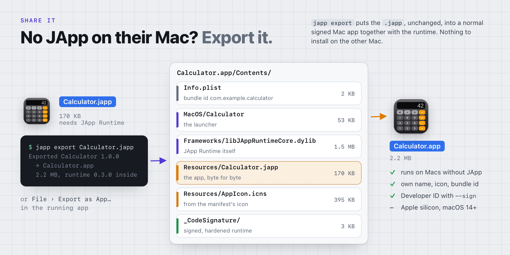
</picture>

One app, two ways to hand it over — no build step in either:

| | **The `.japp` file** | **An exported `.app`** |
|---|---|---|
| The other Mac needs | JApp Runtime | nothing |
| Size (Calculator) | 170 KB | 2.2 MB, mostly the 1.5 MB runtime library |
| Change it | right-click › **Edit JApp Source** | sealed by its signature: edit the `.japp`, export again |
| Runtime updates | every app gets them | frozen at the version it was exported with |
| Runs on | any Mac with JApp Runtime (macOS 14+) | Apple silicon, macOS 14+ |

Send the `.japp` with AirDrop, email or a USB stick; an app downloaded from the
internet asks once before its first run. For a Mac without JApp, choose
**File › Export as App…** in the running app, or:

```sh
japp export build/Calculator.japp            # → ./Calculator.app
japp export ./My\ App --output ~/Desktop     # from a folder, into a folder
japp export App.japp --sign "Developer ID Application: Your Name (TEAMID)"
```

The `.japp` goes into `Calculator.app/Contents/Resources` byte for byte, next to a
copy of the runtime library and the 53 KB launcher; the launcher loads the library
from inside the app, so it never looks for an installed JApp Runtime. A Flash projector, except the app
inside is still plain HTML, CSS and JS that you can read.

The exported app is signed ad hoc by default, so on another Mac macOS blocks the
first open until it is allowed in System Settings › Privacy & Security (**Open
Anyway**). To share it widely, sign it with a Developer ID (`--sign`) and notarize
it — see [CREATING_APPS.md › Sharing an app](Docs/CREATING_APPS.md#sharing-an-app).
On one Mac, the exported app and the `.japp` share `japp.storage`; their
`localStorage` is separate.

## Native features from JavaScript

<picture>
  <source media="(prefers-color-scheme: dark)" srcset="Docs/images/bridge-dark.png">
  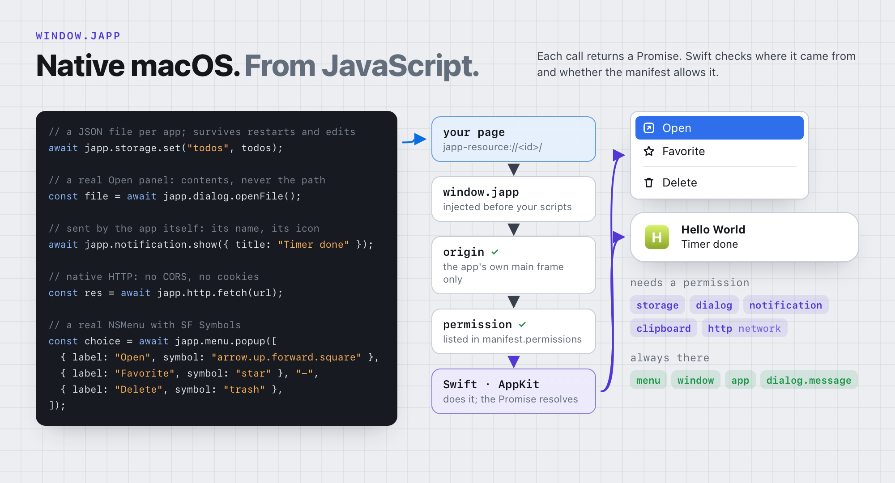
</picture>

`window.japp` is injected into every app: storage, file dialogs, notifications,
clipboard, CORS-free HTTP, native context menus and the window — Promise-based and
permission-checked in Swift. Full reference: **[Docs/API.md](Docs/API.md)**.

```js
await japp.storage.set("username", "Alex");
const username = await japp.storage.get("username");
```

| Module | Permission | |
|---|---|---|
| `japp.storage` | `storage` | JSON key-value store, kept outside the archive |
| `japp.dialog` | `dialog` | Open and Save panels; `message()` needs none |
| `japp.notification` | `notifications` | Sent by the app itself, with its name and icon |
| `japp.clipboard` | `clipboard` | Read and write text |
| `japp.http` | `network` | Native HTTP, not subject to CORS |
| `japp.menu`, `japp.window`, `japp.app` | — | Native context menus, the app's window, its manifest |

## The `japp` command

| Command | |
|---|---|
| `japp new <Name> [--id <id>]` | Create a starter app folder (the template of *File › New App…*) |
| `japp pack <folder> [--output App.japp]` | Validate and package (atomic) |
| `japp unpack <App.japp> [folder]` | Extract safely |
| `japp validate <App.japp\|folder>` | Report every error and warning |
| `japp info <App.japp> [--json]` | Manifest, files, data location |
| `japp run <App.japp\|folder> [--console] [--develop]` | Run; `--console` streams the app's JS console, `--develop` adds the Develop menu |
| `japp edit <App.japp> [--no-window]` | Open the source for editing |
| `japp save <App.japp> [--run] [--close]` | Save edited source back into the `.japp` |
| `japp snapshot <App.japp> [-o shot.png] [--eval js]` | Run headlessly; screenshot + JSON report |
| `japp restore-icon <App.japp>…` | Re-apply Finder icons |
| `japp storage <App.japp\|id> [--clear]` | Show or clear stored data |
| `japp export <App.japp\|folder> [--output Name.app] [--sign identity]` | Standalone `.app` with the runtime inside, for Macs without JApp Runtime |
| `japp bundles [list \| clean \| remove <id>]` | Show or remove the per-app bundles that give apps their own name and Dock icon |
| `japp help [<command> \| api \| format \| guide \| all]` | The complete guide, written for AI coding agents: recipes, rules, manifest, `window.japp`, pitfalls, and where everything is on this Mac |

Pointing an AI coding agent at JApp? Tell it to run `japp help` first: one page has
everything it needs to make, check and ship an app.

## How it works

<picture>
  <source media="(prefers-color-scheme: dark)" srcset="Docs/images/architecture-dark.png">
  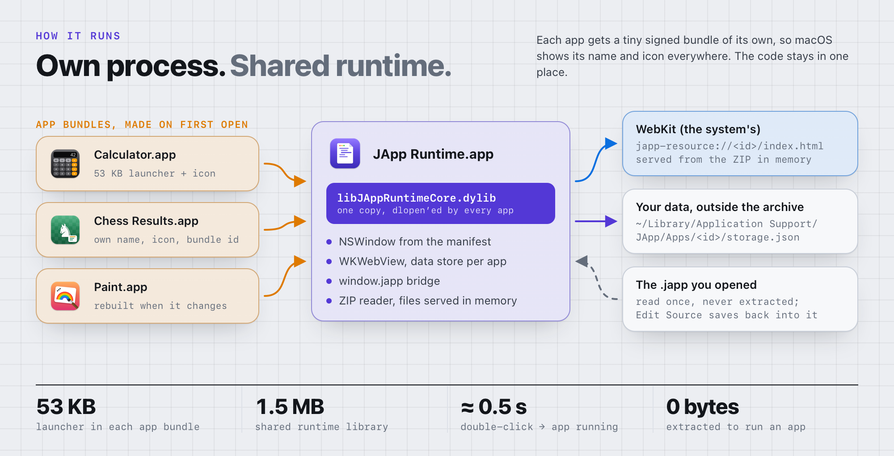
</picture>

* **Runtime** — Swift/AppKit app hosting a `WKWebView` per app. Files are served
  straight from the archive in memory through a `WKURLSchemeHandler` at
  `japp-resource://<app-id>/`; nothing is extracted to run an app.
* **A real app per app** — JApp Runtime generates a tiny signed bundle for each app
  (`~/Library/Application Support/JApp/AppBundles`), so every app runs as its own
  process with its own name in the menu bar, Dock, ⌘-Tab and notifications, its
  own icon, ⌘Q and crash isolation. The bundle holds only a 53 KB launcher that
  loads the runtime from JApp Runtime.app; you can keep it in the Dock.
* **Standalone apps** — `japp export` puts the launcher, the runtime library and the
  `.japp` in one signed `.app`; the launcher loads the library next to it, so nothing
  needs to be installed ([ARCHITECTURE.md › Standalone apps](Docs/ARCHITECTURE.md#10-standalone-apps-japp-export-projector-mode)).
* **Native feel** — no text selection on labels, arrow cursor, no bouncing page,
  no browser context menus or Reload in the menu bar; hidden title bars with
  drag regions, window materials (translucent sidebars), window state for CSS
  ([API.md › Native look and feel](Docs/API.md#native-look-and-feel)).
* **Data** — kept outside the archive in `~/Library/Application Support/JApp/Apps/<id>/`, keyed by app id.
* **Icons** — the icon inside the archive becomes the Dock icon and, via
  `NSWorkspace.setIcon`, the file's Finder icon.
* **Editing** — unpacks into a workspace, opens your code editor, and saves back
  atomically with validation and backups ([ARCHITECTURE.md](Docs/ARCHITECTURE.md)).

## Security

<picture>
  <source media="(prefers-color-scheme: dark)" srcset="Docs/images/security-dark.png">
  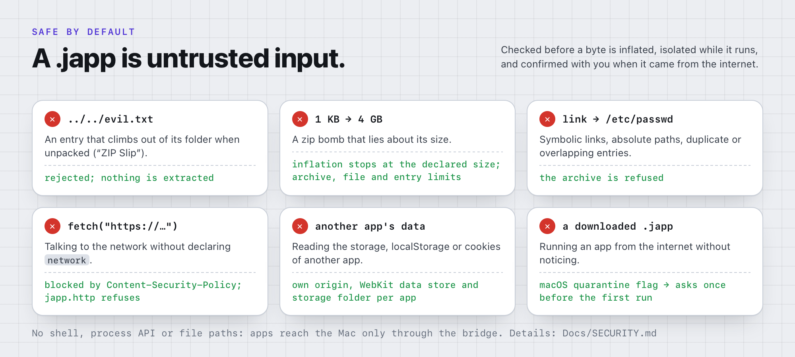
</picture>

Strict ZIP validation (ZIP Slip, bombs, symlinks), per-app origin and data store,
CSP-enforced network permission, origin-checked bridge, confirmation for
downloaded apps. Threat model and known limitations: **[Docs/SECURITY.md](Docs/SECURITY.md)**.

## Status of the MVP

| Acceptance criterion | Status |
|---|---|
| Runtime builds and installs | ✅ `Scripts/build.sh`, `Scripts/install.sh` |
| macOS recognises `.japp` | ✅ UTI `dev.japp.app`, default app verified via Launch Services |
| Double-click launches Calculator | ✅ via `open` (the Launch Services path Finder uses); physical double-click not automated |
| Native window, own title | ✅ verified (title, size) |
| HTML/CSS/JS run correctly | ✅ e2e tests drive the UI |
| Custom icon | ✅ Finder icon verified; Dock icon set via API (Dock not observed) — see limitations |
| Persistent storage from JS | ✅ survives restarts (tested) |
| Open and modify source | ✅ Services item, menu, CLI; editor hand-off tested with Finder |
| Save back into the `.japp` | ✅ validated, atomic, backed up (tested) |
| Relaunch shows changes | ✅ tested (relaunch and in-place reload) |
| New apps need no runtime rebuild | ✅ *File › New App…*, `japp new` / zip |
| Instructions for new apps | ✅ [CREATING_APPS.md](Docs/CREATING_APPS.md) |

What was tested automatically, by hand, and what still needs a person at the
Mac: **[Docs/TESTING.md](Docs/TESTING.md)**.

### Known limitations

* Opening a `.japp` passes through JApp Runtime (hidden, ~0.6 s) before the app's
  own bundle starts; see [ARCHITECTURE.md](Docs/ARCHITECTURE.md#3-one-process-per-app-each-in-a-bundle-of-its-own).
  An app renamed while it runs keeps its old name in the menu bar until it is reopened.
* Finder icons are file metadata and are lost when a file is emailed or
  downloaded; the runtime restores them when the app is opened.
* The runtime is ad-hoc signed and not sandboxed; see [SECURITY.md](Docs/SECURITY.md#known-limitations).

## Repository layout

```
Package.swift            SwiftPM package (no dependencies)
Sources/JAppKit/         core: ZIP, manifest, packaging, storage, workspaces
Sources/JAppRuntime/     the macOS app (AppKit + WebKit)
Sources/japp/            the command-line tool
Tests/JAppKitTests/      unit tests (swift test)
Tests/E2E/               end-to-end test script and helpers
Examples/                Calculator, ChessResults, Paint (sources of the .japp files)
Resources/               Info.plist, runtime and document icons
Scripts/                 build.sh, install.sh, e2e-test.sh, make-icons.swift
Docs/                    FORMAT, API, CREATING_APPS, ARCHITECTURE, SECURITY, TESTING
Docs/images/             the pictures in this README; src/make.sh renders them with JApp itself
```

Uninstall: delete `/Applications/JApp Runtime.app`, `/usr/local/bin/japp` and
`~/Library/Application Support/JApp`.
